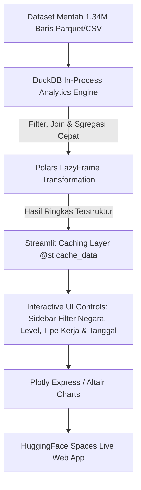

# Dokumen Arsitektur & Pitch Proposal Produk Data (Phase 1)

**Mata Kuliah:** Analisis Big Data  
**Target Check-in:** Pertemuan 10 (Diumumkan Pertemuan 8, repositori dibagikan Pertemuan 9)  
**Nama Tim:** Powerpuff  
**Topik / Judul Produk Data:** Dashboard Analitik Pasar Kerja Global dan Pemetaan Kebutuhan Skill  

---

## 1. Problem Statement & Sasaran Pengguna (The Pitch)

### 1.1 Latar Belakang Masalah
Salah satu penyebab utama tingginya angka pengangguran terdidik adalah kesenjangan kompetensi (skill gap) antara keterampilan yang dimiliki pencari kerja dengan kebutuhan industri yang terus berkembang. Dataset lowongan kerja LinkedIn berskala besar (lebih dari 1,3 juta baris) menyimpan pola penting mengenai tren lowongan, sebaran negara/kota, sistem kerja (remote/hybrid/onsite), level jabatan, serta skill yang paling dibutuhkan, namun terlalu besar untuk diolah menggunakan spreadsheet biasa. Oleh karena itu, diperlukan dashboard analitik interaktif yang mampu memproses jutaan baris data secara efisien agar pengguna dapat mengeksplorasi pasar kerja secara cepat dan terarah.

### 1.2 Target Pengguna (Target Audience)
- Pencari kerja dan mahasiswa tingkat akhir 
- Institusi pendididkan dan lembaga pelatihan (kampus/bootcamp)
- Tim HR, rekruter, dan analis pasar kerja

### 1.3 Nilai Tambah & Wawasan Utama
Setelah berintraksi dengan dashboard ini, pengguna dapat: 
- Mengidentifikasi posisi pekerjaan dan skill paling diminati berdasarkan negara, kota, tipe kerja, dan level jabatan.
- Melihat trend waktu publikasi lowongan serta perbandingan proporsi kerja remote, hybrid, dan onsite.
- Mengambil keputusan berbasis data, seperti menentukan fokus belajar skill bagi pencari kerja atau merancang program pelatihan guna menekan skill gap.

---

## 2. Sumber Dataset & Skala Data

| Parameter | Keterangan |
|-----------|------------|
| **Nama Dataset** | 1.3M LinkedIn Jobs & Skills (2024) |
| **Sumber Resmi** | https://www.kaggle.com/datasets/asaniczka/1-3m-linkedin-jobs-and-skills-2024 |
| **Format Awal** | CSV |
| **Ukuran Data** | 1,34 juta baris |
| **Dimensi Waktu / Temporal** | Januari 2024 (`first_seen` dan `last_processed_time`, frekuensi harian) |
| **Fitur / Kolom Kunci** | `job_link, job_title, company, job_location, search_country, search_city, first_seen, job_level, job_type, job_skills` |

---

## 3. Diagram Arsitektur Data & Aliran Informasi

Gambarkan alur bagaimana data mengalir dari disk mentah hingga ke antarmuka pengguna:

---

## 4. Rencana Pemrosesan Data & Strategi Caching

### 4.1 Peran DuckDB (SQL Engine)
- Membaca file Parquet hasil pembersihan (`linkedin_job_postings.parquet` dan `job_skills.parquet`) secara langsung tanpa memuat seluruh data ,entah ke RAM.
- Menjalankan operasi analitik berat seperti `SUMMARIZE`, filter dinamis berdasarkan negara/level/tipe kerja, join antara tabel lowongan dan skill melalui `job_link`, serta agregasi per negara, perusahaan, dan tanggal. 

### 4.2 Peran Polars (Transformasi Data)
- Pembersihan data awal(penanganan nilai kosong, normalisasi teks, deduplikasi bredasarkan `job_link`), konversi CSV ke Parquet terkompresi (`zstd`).
- TRansformasi lanjutan menggunakan `LazyFrame`, seperti pemecahan daftar `job_skills` (tokenisasi/explode skill), perhitungan moving average tren harian, serta perankingan top skill per kategori jabatan.

### 4.3 Strategi Optimasi Memori & Caching Streamlit
- Menggunakan `@st.cache_data` pada fungsi DuckDB/Polars agar hasil agregasi tersimpan di cache dan dashboard tetap responsif saat pengguna mengubah filter.
- Tidak memuat file `job_summary.csv` (5 GB) ke dalam aplikasi production dan tidak menyimpan 1,3 juta baris mentah di `st.session_state` agar pemakaian memori tetap jauh di bawah batas 16 GB RAM gratis HuggingFace Spaces.

---

## 5. Rencana Tampilan Dashboard (Wireframe & Fitur UI)

1. **Header & Key Metrics KPI:**
   - 4 Kartu metrik ringkasan (Total Lowongan Terfilter, Jumlah Perusahaan Unik, Persentase Pekerjaan Remote/Hybrid, dan Skill Paling Dicari).
2. **Filter Interaktif (Sidebar):**
   - Pilihan negara (`search_country`), tipe kerja (`job_type`: Onsite/Remote/Hybrid), level jabatan (`job_level`), rentang tanggal (`first_seen`), dan kata kunci posisi/skill.
3. **Panel Visualisasi Utama:**
   - **Tab 1 — Tren Temporal Lowongan:** Line chart interaktif jumlah lowongan harian beserta moving average.
   - **Tab 2 — Analisis Skill & Distribusi Jabatan:** Bar chart Top 20 skill paling dibutuhkan serta distribusi `job_level` dan `job_type`.
   - **Tab 3 — Sebaran Wilayah & Perusahaan:** Peta choropleth / bar chart negara & kota dengan lowongan terbanyak serta Top perusahaan perekrut.
   - **Tab 4 — Tabel Data Detail:** Tampilan cuplikan data lowongan terfilter dengan opsi download ringkasan CSV.

---

## 6. Pembagian Tugas & Tanggung Jawab Anggota Tim

| Anggota Tim | Tanggung Jawab Utama di Phase 1 - 4 |
|-------------|-------------------------------------|
| Tia Dwi Febrianti | Desain arsitektur, data pipeline, dan integrasi Dockerfile |
| Andini Wardaningrum | Penyusunan kueri analitik DuckDB dan optimasi partisi Parquet |
| Jelita Aufashshifaari Zahda Putri Prayitno | Desain antarmuka Streamlit, visualisasi Plotly, dan deployment ke HF Spaces |
